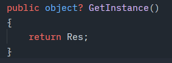
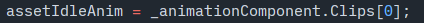
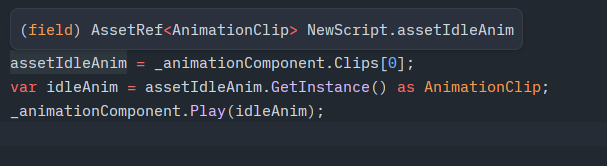
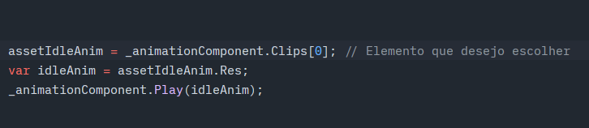
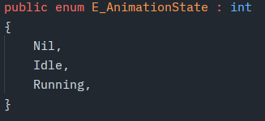
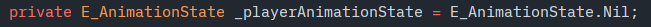
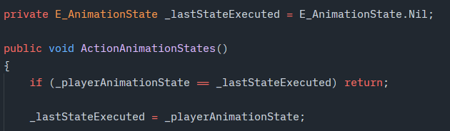

# AnimationComponent (Deprecated)

[Leia em português](README.md)

> **Notice:** this component is deprecated. The notes below document the existing implementation.

## Selecting an animation

Playing a specific animation requires an `AssetRef` converted to the expected type. You can also retrieve an animation from the list stored in `AnimationComponent` with `GetInstance`; because this method returns an object, a cast is required.

You can select a specific clip by its index.

Another option is to use `RES` on the `AssetRef`.

These implementations rely on the animation list owned by the component.

## State machine with animations

When using a State Machine, compare the previous action with the current action, then update the previous value after the comparison. Because this runs every frame, failing to update the state can cause the animation to keep repeating.

