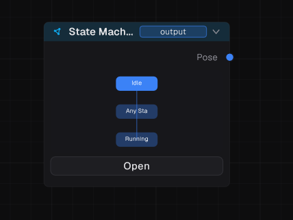
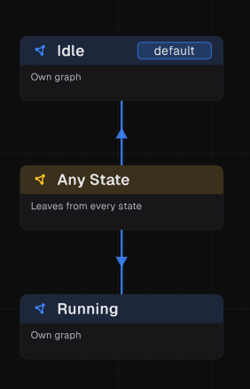
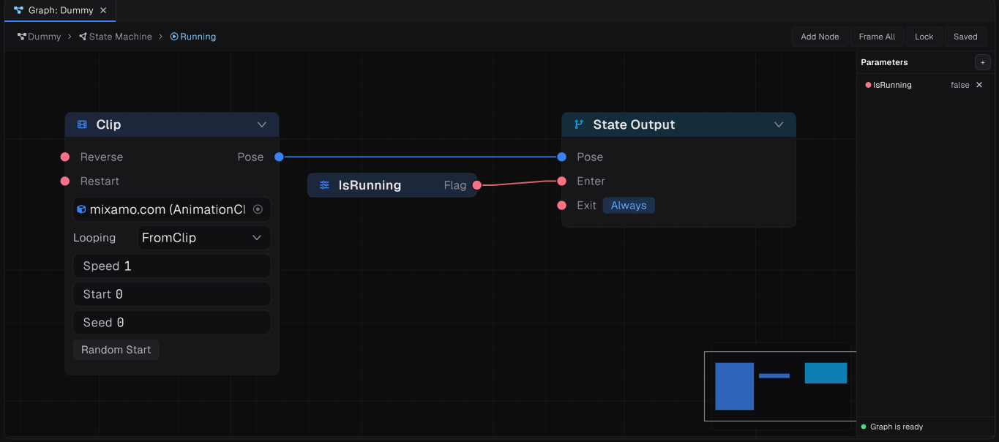
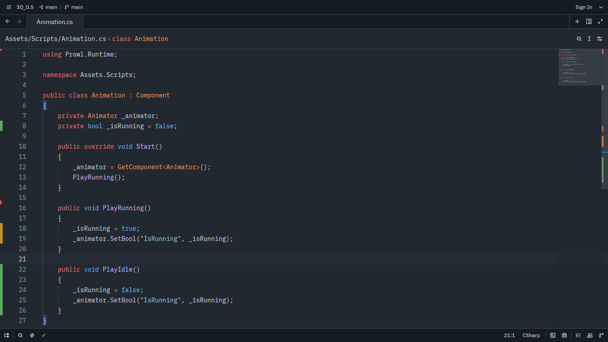

# Animation Graph

[Leia em português](README.md)

## State machine setup

To play animations, create a **State Machine** and connect its output (`Output`).

Add states for the animations and a transition state. **Only one transition state is supported.** Set one animation state as the default and leave it unconnected to parameters; it will be the default fallback state.

## Control parameters

Use custom parameters to control animation flow. Set these parameters from code.

The assignment API uses the `Set` prefix followed by the corresponding data type.

The method/function's first argument must match the parameter name in the Animation Graph. Its second argument must match that parameter's data type.

## Recommendation

Avoid using raw strings to identify parameters. Consider using an `enum` and a `switch` to return the correct parameter name, or constants (`const`) for a simpler approach. This reduces typos and makes the code easier to maintain.
