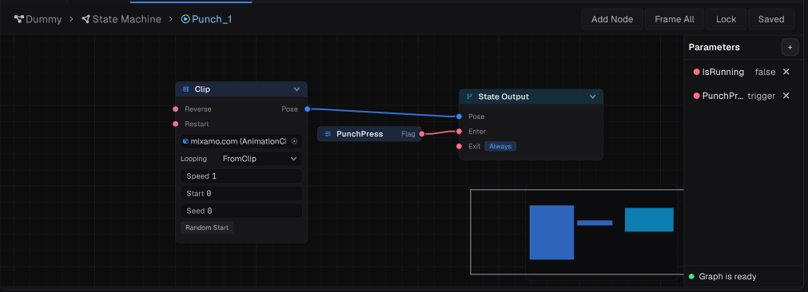

# Animation Graph

[Read in English](README.en.md)

## Configuração da máquina de estados

Para executar animações, crie uma **State Machine** e conecte sua saída (`Output`).

Adicione states para as animações e um state de transição. **Apenas um state de transição é aceito.** Defina um dos states de animação como padrão (`default`) e deixe-o sem conexão a parâmetros; ele será o state de retorno padrão.

## Parâmetros de controle

Use parâmetros personalizados para controlar o fluxo da animação. Esses parâmetros devem ser definidos pelo código.

A API de atribuição usa o prefixo `Set`, seguido pelo tipo de dado correspondente.

O primeiro argumento do método/função deve corresponder ao nome do parâmetro no Animation Graph. O segundo argumento deve corresponder ao tipo de dado desse parâmetro.

### Diferença entre Flag e Trigger

`Flag` representa um estado booleano (`true`/`false`) que permanece definido até ser alterado. `Trigger` é um disparo de uso único: ativa a transição ou ação associada uma vez, em vez de manter um estado booleano ativo.

## Recomendação

Evite usar strings literais (`raw strings`) para identificar parâmetros. Considere usar `enum` e um `switch` para retornar o nome correto do parâmetro, ou constantes (`const`) se preferir uma abordagem mais simples. Isso reduz erros de digitação e facilita a manutenção.
